# Introdução

## Objetivos

### Objetivos

<!-- Motivacao: trabalho de conclusao de curso, palestra sobre metodos mais leves de NER, e a busca por metodos melhores que LLM -->

- Mapear as possibilidades de uso desses modelos na horus CDA no curto prazo, com as plataformas usadas atualmente pelas equipes.

- Compreender o potencial de uso dessas tecnologias, que se encontram no limiar entre a IA generativa, *machine learning* e engenharia de dados, equipando os times com as informações indispensáveis para a criação de soluções ainda mais personalizadas e criativas.

- Trazer esse conhecimento como diferencial para a *expertise* do quadro técnico da horus CDA, posicionando-se sempre à frente no conhecimento do estado da arte em pesquisa científica e inteligência de mercado.

<!-- Contexto: mercado em IA em Salvador -->

## Histórico da IA

### Histórico da IA

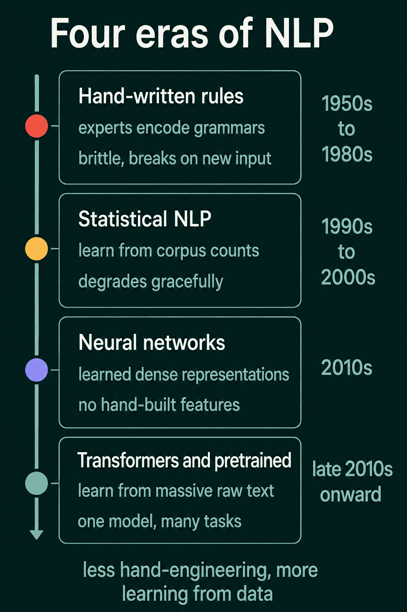{length=60%}

## Histórico dos Transformers

### Histórico dos Transformers

# Modelos 

## Arquiteturas

### Arquiteturas

<!-- Comentar sobre o quanto usar um decoder para uma tarefa que um encoder poderia realizar seria custoso -->

<!-- Contexto: nao focaremos sobre modelos de busca semantica -->

### Treinamento

{width=80%}

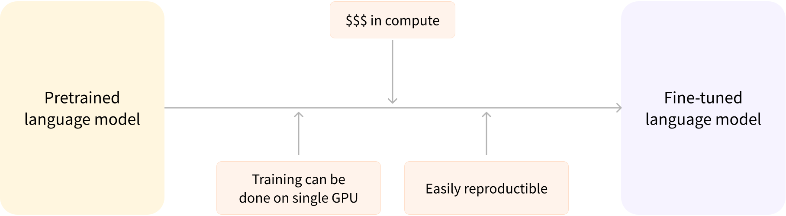{width=80%}

<!-- Comentar sobre encoders precisarem serem treinados sob medida: dominio do texto, e BERT originais em ingles -->

<!-- Comentar sobre familiaridade do publico sobre esses modelos -->

### Encoder-Decoders

<!-- O que e zero shot? Explicar -->

## Tarefas de Encoders

### Encoders

### Encoders

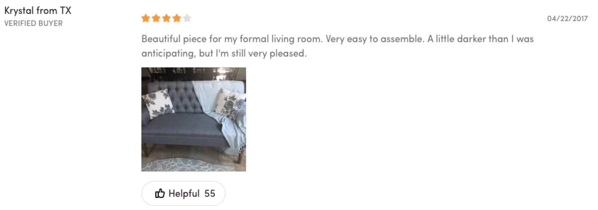

### Encoders

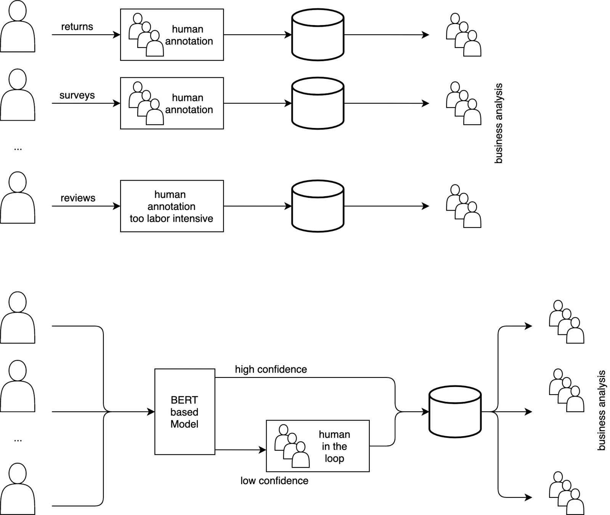

### Encoders

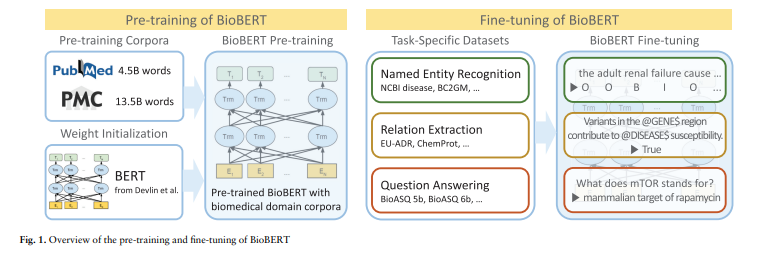

## Vantagens e Desvantagens

### Vantagens e Desvantagens

| BERT | LLMs |
| --- | --- |
| Melhor quando feito sob medida: exige muitos dados rotulados | Melhor capacidade *zero-shot* |
| Não alucina, por ser de classificação: erros são mais fáceis de detectar | Suscetível a alucinações |
| Menor custo computacional (MBs de RAM) - pode ser utilizado em *hardware* comum | Maior custo computacional (GBs de RAM+) - geralmente exige GPUs de última geração |
| Comumente hospedado localmente | Uso de modelos de API podem ferir normas de segurança e privacidade |
| Em geral, em inglês (português subrepresentado) | Em geral, multilíngues |

# Conclusão

## Qlik

### Qlik

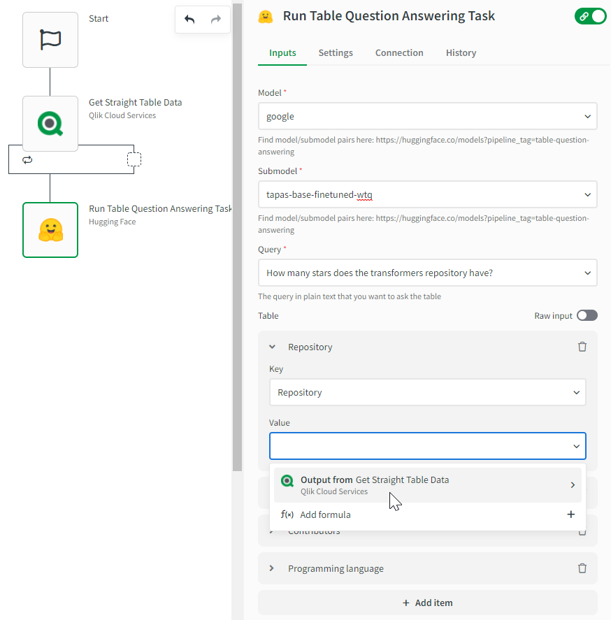{width=60%}

### Qlik

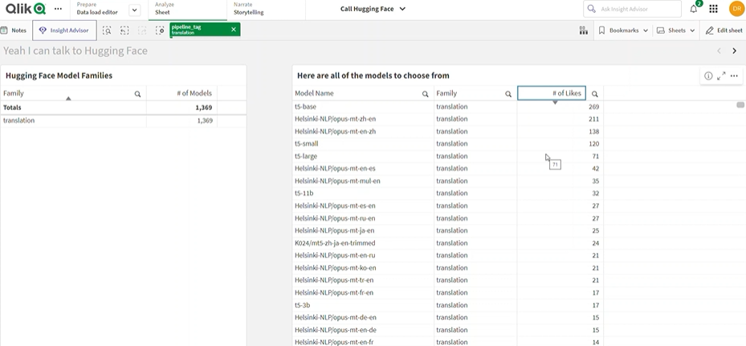

### Qlik

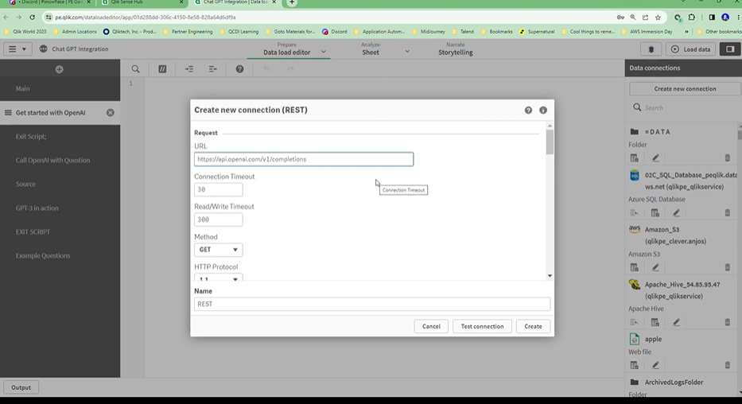

## Alteryx

### Alteryx

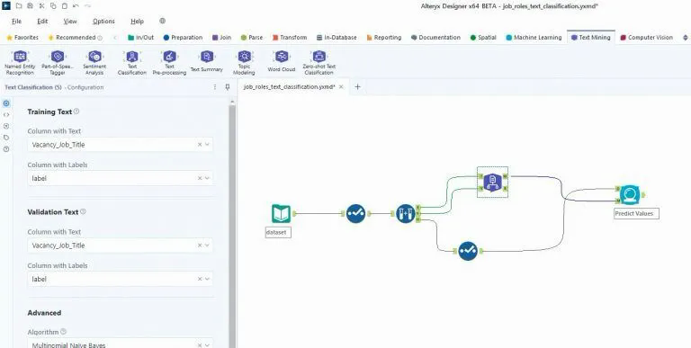

<!-- Falar sobre limitacao do Python Tool -->

### Alteryx

\scriptsize
\setlength{\tabcolsep}{3.5pt}

| Redes Neurais (spaCy) | Redes Neurais (outros) | Heurísticas | Métodos Estatísticos (scikit-learn) | Desconhecido | Transformers |
| --- | --- | --- | --- | --- | --- |
| NER, análise de classe gramatical, Lematização | Classificação de texto | Análise de sentimento, Resumos | Modelagem de tópicos | Nuvem de palavras | Classificação Zero-shot

### Alteryx

\scriptsize
\setlength{\tabcolsep}{3.5pt}

| Tool | EN | FR | DE | JA | ES-LA | PT-BR | IT | ZH-CN |
|---|:---:|:---:|:---:|:---:|:---:|:---:|:---:|:---:|
| Text Pre-processing | X | X | X | | X | X | X | |
| Sentiment Analysis | X | | | | | | | |
| Word Cloud | X | X | X | | X | X | X | |
| Topic Modeling | X | X | X | | X | X | X | |
| Named Entity Recognition | X | X | X | | X | X | X | |
| Part-of-Speech Tagger | X | X | X | | X | X | X | |
| Text Summary | X | X | X | | X | X | X | |
| Zero-shot Text Classification | X | | | | | | | |
| Text Classification | X | X | X | | X | X | X | |

## SAS

### SAS

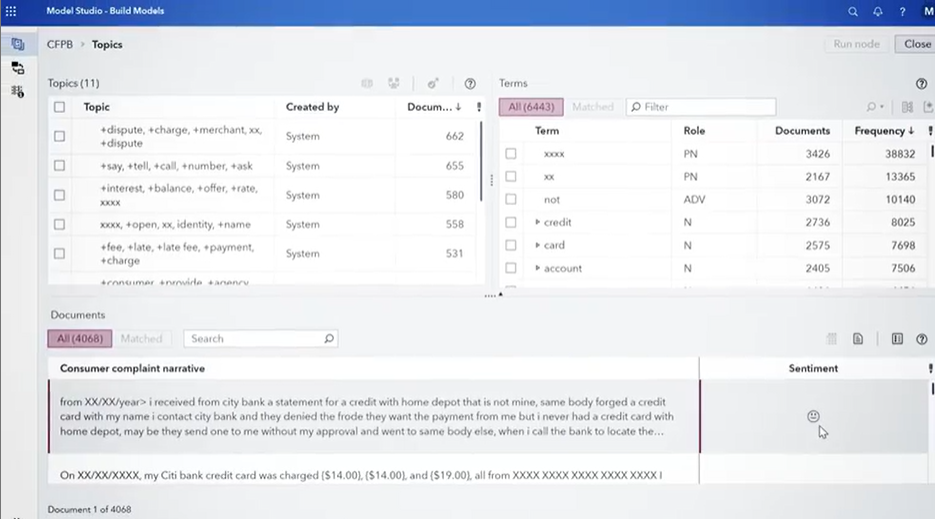

### SAS

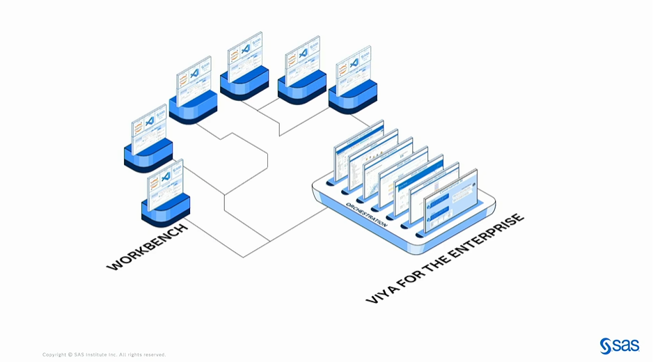

### SAS

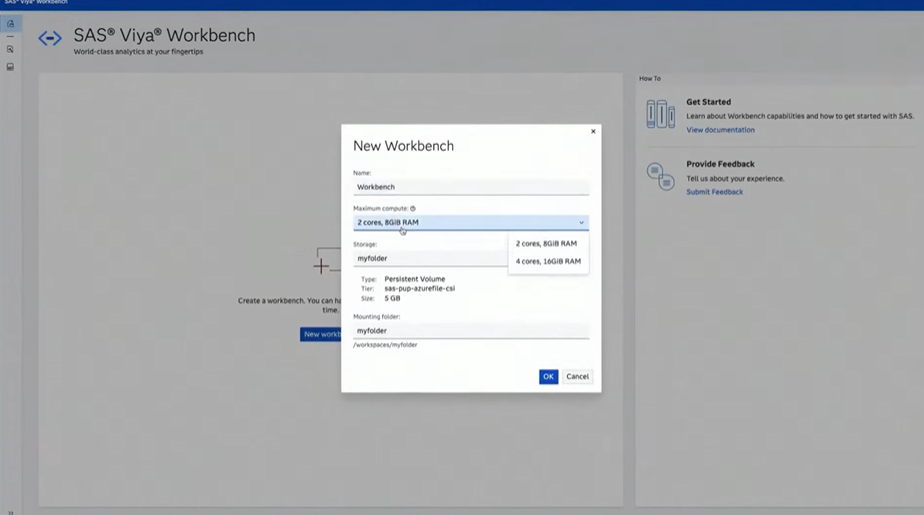

### SAS

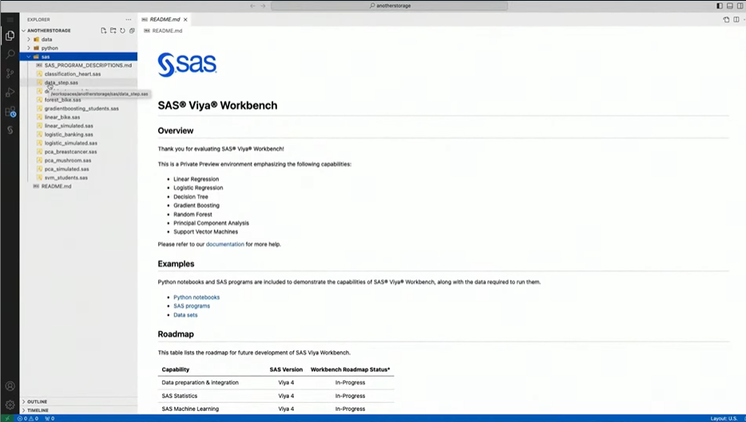

### SAS

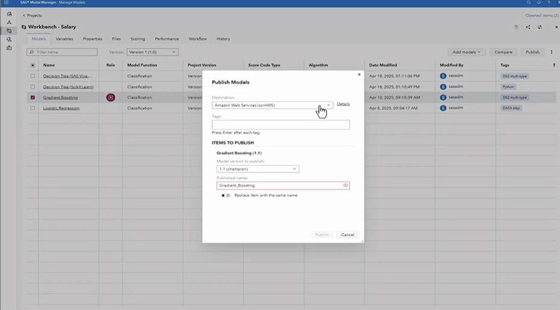

## Links Úteis

### Links Úteis

https://aiengineeringfromscratch.com/learn/transformers-deep-dive/why-transformers

https://huggingface.co/learn/llm-course/en/chapter1/1
