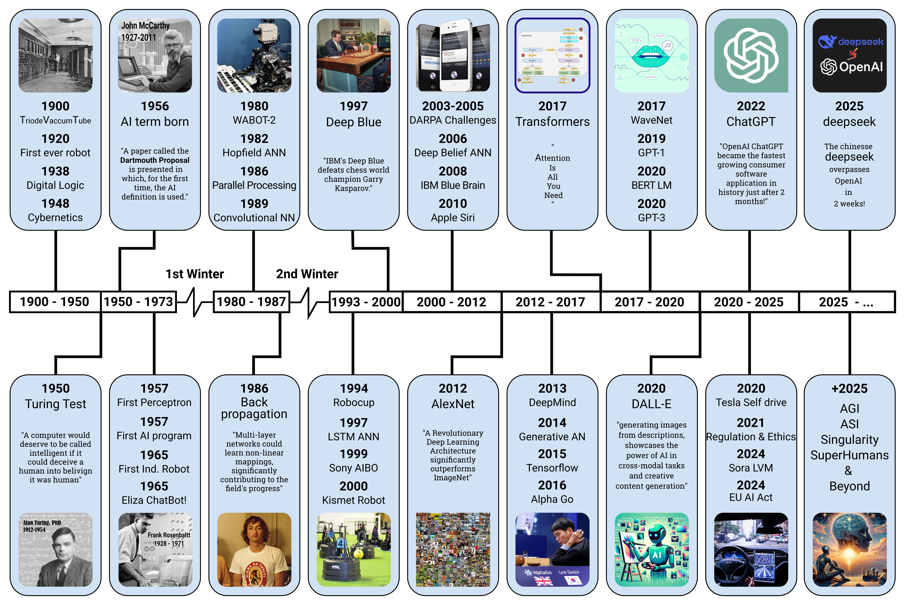
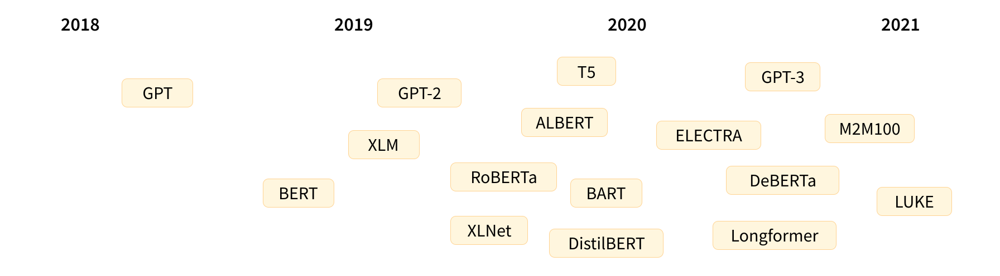
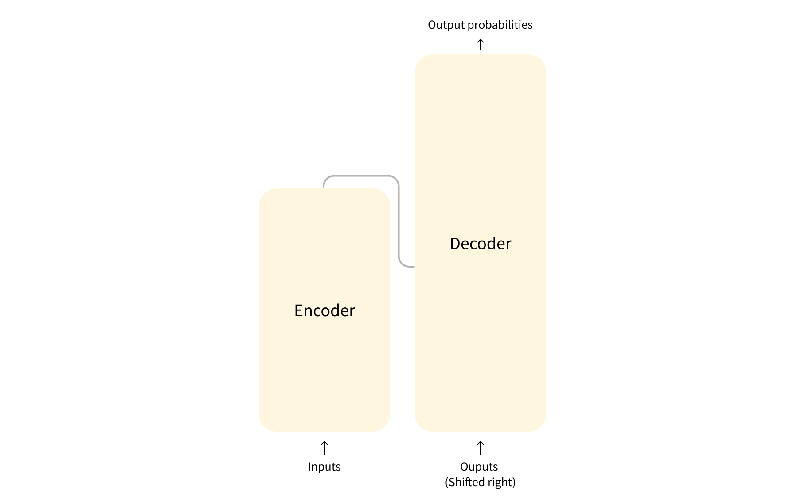
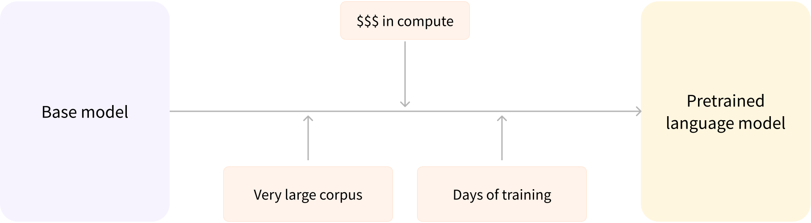
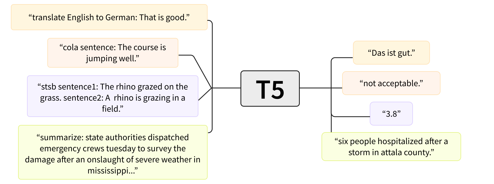
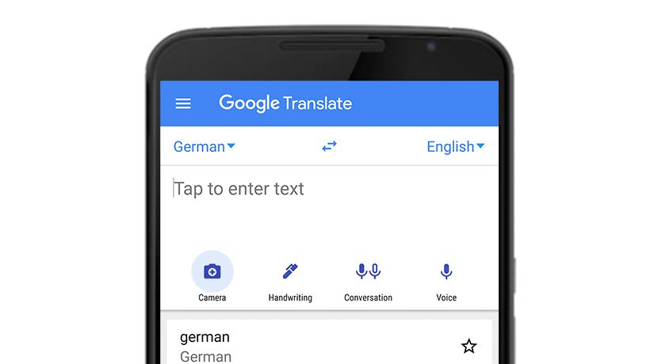
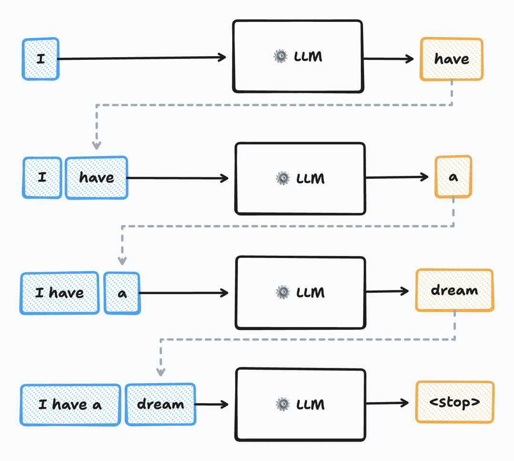
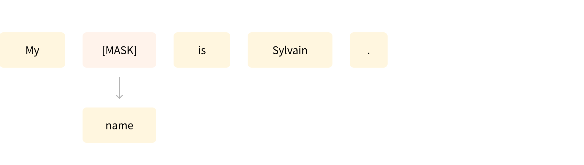
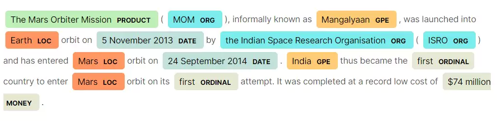

# Introdução

## Objetivos

### Objetivos

- Mapear as possibilidades de uso desses modelos na horus CDA no curto prazo, com as plataformas usadas atualmente pelas equipes.

- Compreender o potencial de uso dessas tecnologias, que se encontram no limiar entre a IA generativa, *machine learning* e engenharia de dados, equipando os times com as informações indispensáveis para a criação de soluções ainda mais personalizadas e criativas.

- Trazer esse conhecimento como diferencial para a *expertise* do quadro técnico da horus CDA, posicionando-se sempre à frente no conhecimento do estado da arte em pesquisa científica e inteligência de mercado.

## Histórico da IA

### Histórico da IA

{width=90%}

## Histórico dos Transformers

### Histórico dos Transformers

# Modelos 

## Modelos

### Arquiteturas

### Treinamento

### Encoder-Decoders

### Encoder-Decoders

### Decoders

### Encoders

### Encoders

# Conclusão

## Referências

### Referências

Anexo:Cronología de la inteligencia artificial - Wikipedia, la enciclopedia libre. Disponível em: <https://es.wikipedia.org/wiki/Anexo:Cronolog%C3%ADa_de_la_inteligencia_artificial>. Acesso em: 21 nov.. 2026.

How do Transformers work? - Hugging Face LLM Course. Disponível em: <https://huggingface.co/learn/llm-course/chapter1/4>. Acesso em: 21 nov.. 2026.

https://huggingface.co/learn/llm-course/chapter1/4

https://huggingface.co/learn/llm-course/en/chapter7/5

https://pm.dartus.fr/posts/2025/how-llm-generate-text/
