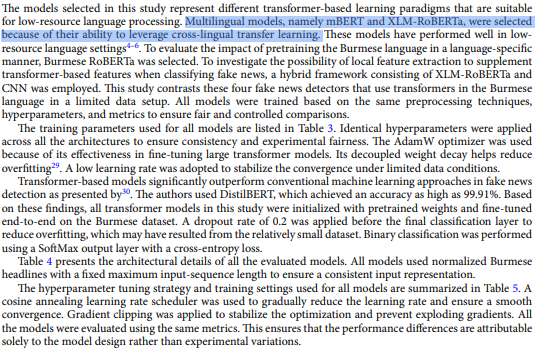
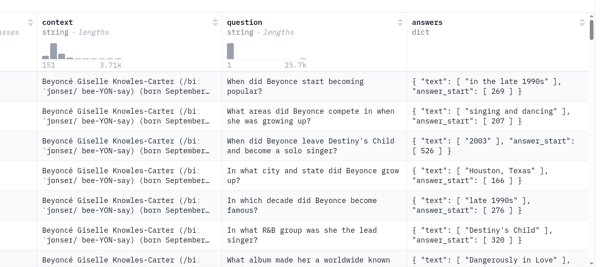
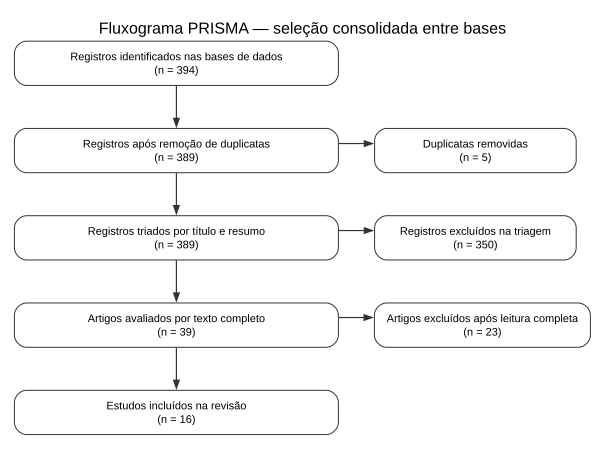
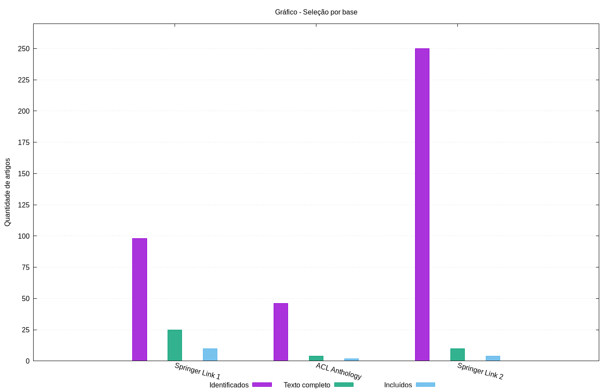

# Objetivo de Pesquisa

Sintetizar evidências sobre transferência entre idiomas e tamanho de contexto em modelos BERT/encoder-only, com foco em QA extrativo e português.

# Questões de Pesquisa

- Qual o estado da arte no QA Extrativo?

- Como o alinhamento entre a língua do pré-treinamento e do *fine-tuning* influencia o desempenho de modelos baseados em BERT em QA extrativo, entre outras tarefas *downstream?*

- Como a literatura caracteriza o desempenho qualitativo de modelos *encoder-only* monolíngues e multilíngues em tarefas de QA extrativo em português, dentre outras tarefas *downstream?*

- Qual é a influência do tamanho do texto a ser processado no desempenho qualitativo de modelos baseados em BERT para tarefas *downstream,* em particular o QA Extrativo?

# Mecanismo Principal

# Base de Dados

# O problema investigado: responder bem em outra língua e em textos longos

::: {.block}
### QA extrativo
Dada uma pergunta e um texto, o modelo identifica e retorna o trecho que contém a resposta.
:::

::: {.block}
### Transferência translíngue
Um modelo treinado em certos idiomas é aplicado a outro; por exemplo, do inglês para o português.
:::

::: {.block}
### Contexto longo
O texto pode ultrapassar o limite máximo de caracteres suportado por modelos BERT, exigindo localizar evidências distantes.
:::

# Modelos de Perguntas e Respostas

::: {.block}
### Modelos BERT *(encoder-only)*
Atenção bidirecional nativa sem perda de foco em tokens
distantes. Alta precisão na delimitação de índices de
respostas, menor latência e custo computacional reduzido
sem risco de alucinações.
:::

::: {.block}
### LLMs Generativos
Decaimento de atenção em trechos distantes durante a
geração. Dificuldade empírica na identificação exata de
spans de texto em tarefas formais de Question Answering
Extrativo.
:::

# Seleção e Mapeamento dos Artigos

# Seleção e Mapeamento dos Artigos

# QP1: Estado da Arte em QA Extrativo

::: {.block}
### Atenção Bidirecional Superior
Modelos encoder-only dominam benchmarks de QA extrativo por preservarem contexto completo sem perda de atenção em trechos distantes.
:::

::: {.block}
### Métricas Padronizadas
A avaliação consolida-se através de Exact Match (EM) e token-level F1-score sobre datasets de referência como o SQuAD 2.0.
:::

::: {.block}
### Escolha de Modelos
Modelos generativos apresentam imprecisão na identificação de índices exatos, tornando os encoders a escolha ideal para extração rígida de passagens.
:::

# QP2: A "Maldição da Multilingualidade"

::: {.block}
### Modelos Multilíngues (mBERT/XLM-R)
Permitem transferência para idiomas com baixos recursos computacionais ao capturar relações estruturais genéricas. Gargalo: Degradação de desempenho à medida que a quantidade de línguas cobertas aumenta.
:::

::: {.block}
### Modelos Monolíngues Nativos
Especialização profunda no léxico e gramática local, superando modelos multilíngues de maior porte. Vantagem: Maior alinhamento em nuances culturais, termos regionais e linguagem informal.
:::

# QP3: Modelos Encoder-Only para a Língua Portuguesa

::: {.block}
### BERTimbau
Consolidou a superioridade monolíngue sobre modelos multilíngues em tarefas clássicas de inferência no português.
:::

::: {.block}
### BERTomelo
Especializado com datasets jurídicos nativos (LeNER-Br), superando baselines em acurácia e Fl-score.
:::

::: {.block}
### NorBERTO
Baseado em ModernBERT e treinado em 331B tokens; destaca-se pela alta eficiência mesmo com menor contagem de parâmetros.
:::

Importante destacar que parte dessa evidência vem de tarefas relacionadas, como NER ou classificação, não exclusivamente de QA extrativo.

# QP4: O Desafio do Processamento de Longos Contextos

::: {.block}
### Potencial Teórico
Mecanismos de self-attention bidirecional distribuem a relevância semântica uniformemente ao longo do texto.
:::

::: {.block}
### Limitação Empírica
Excesso de detalhes ruidosos ("muitos detalhes") pode prejudicar a precisão da extração em documentos extensos.
:::

Contexto longo segue como lacuna, devido a evidência ainda insuficiente especialmente para QA Extrativo.

# Síntese de Evidências

::: {.block}
### Fortes
Transferência multilíngue é possível; alinhamento do idioma influencia o desempenho; modelos nativos podem superar multilíngues.
:::

::: {.block}
### Indiretas
Resultados de NER e classificação ajudam a contextualizar; benchmarks traduzidos podem introduzir ruído; vantagens de BERT dependem da tarefa e da avaliação.
:::

::: {.block}
### Lacunas Abertas
Poucos estudos combinam QA extrativo, português e contexto longo; falta comparação controlada entre janelas de contexto; ModernBERT merece avaliação empírica específica.
:::

# Trabalhos Futuros

::: {.block}
### Avaliação de Janelas Expandidas
Investigar empiricamente o comportamento do QA extrativo sob janelas de 8192 tokens no ModernBERT, variando tamanhos de entradas.
:::

::: {.block}
### Datasets Nativos em Português
Investigar conjuntos de dados de QA de longo contexto não traduzidos para o idioma luso-brasileiro.
:::

::: {.block}
### Métricas
Usar EM e F1.
:::

# Conclusão

Português + QA extrativo + janelas longas formam uma lacuna de pesquisa relevante.

# Referências

https://huggingface.co/datasets/rajpurkar/squad_v2/viewer

., C., Kyaw, K.T., Jain, R. et al. A systematic evaluation of transformer-based architectures for fake news detection in the low-resource Burmese language. Sci Rep 16, 25667 (2026). https://doi.org/10.1038/s41598-026-56647-7
